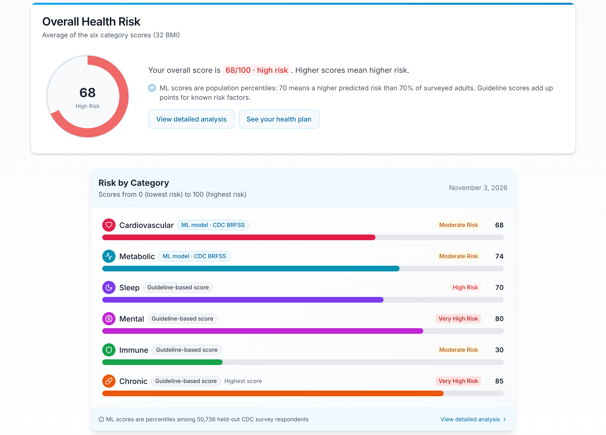
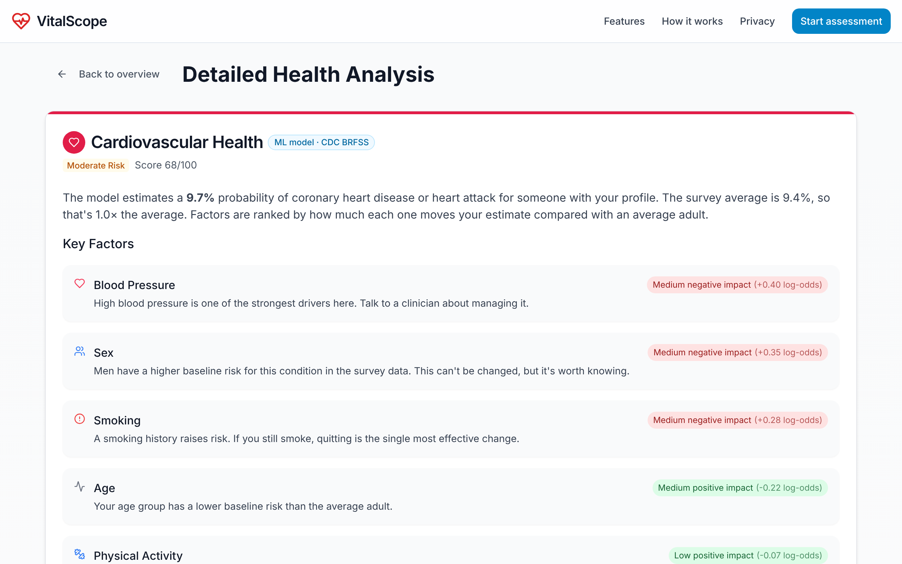
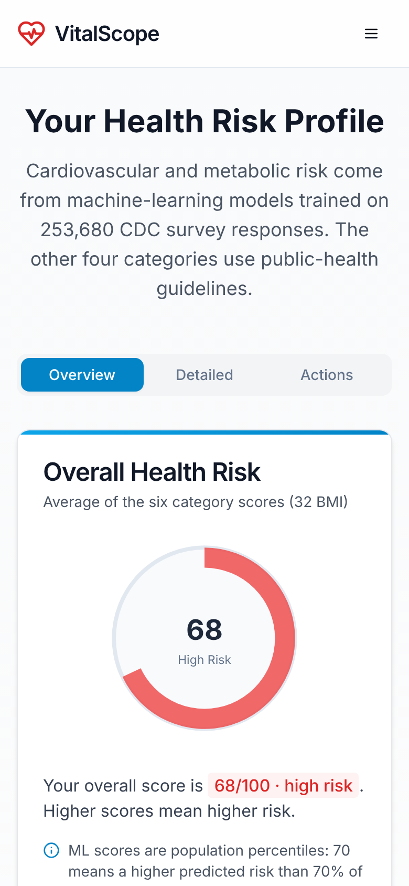

# VitalScope: ML Health Risk Assessment

[](https://github.com/Hemanth2709/Health-predict/actions/workflows/ci.yml)


VitalScope estimates your **cardiovascular and metabolic risk** with machine-learning models trained on **253,680 CDC survey responses**, then explains which factors raise or lower each score. It's a 3-minute, three-step questionnaire with no sign-up, and your answers are never stored.

<!-- Add your deployment URL here once it is live: **[Live demo →](https://your-app.vercel.app)** -->



| Explainable factors | Mobile |
|---|---|
|  |  |

---

## Features

- **Real ML models.** Logistic regression trained on the [CDC Diabetes Health Indicators](https://archive.ics.uci.edu/dataset/891/cdc+diabetes+health+indicators) dataset (BRFSS 2015). It's evaluated against gradient boosting and a baseline, and checked with 5-fold cross-validation.
- **Explainable scores.** Every ML score lists each factor's contribution to the log-odds compared with the average adult.
- **Honest labelling.** Sleep, mental, immune and chronic scores are clearly marked as *guideline-based heuristics*, because the dataset doesn't cover those outcomes.
- **Private by design.** Answers are validated and scored in memory, then discarded. Nothing is written to a database, file or log. Results live in `sessionStorage`, and share links contain only the six scores.
- **PDF report and 90-day plan**, generated in the browser with jsPDF (loaded on demand).
- **One schema everywhere.** The same zod schema validates every form step and the API request.
- **Accessible and responsive.** Labelled form fields, ARIA meters for the scores, a skip link, reduced-motion support and a mobile navigation menu.

## How the prediction works

```
Questionnaire ──► POST /api/predict ──► zod validation ──► feature mapping ──► logistic regression ──► percentile + explanations
   (client)          (Next.js route)    lib/health/schema   lib/ml/features    lib/ml/model.json        lib/risk/assess
                                                                                     ▲
                                                ml/train.py (scikit-learn) ──────────┘  exported coefficients
```

1. `ml/train.py` builds features from the dataset: BMI and BMI², 5-year age-group dummies, high blood pressure, high cholesterol, smoking history, stroke, physical activity, fruit and vegetable intake, sex, and existing heart disease or diabetes. It trains one model per target and writes the coefficients, training means and a 101-point percentile table to `lib/ml/model.json`.
2. The Next.js API route maps the form answers to the same features. An "I don't know" answer falls back to the training mean. The route computes the probability, its percentile among 50,736 held-out respondents, and per-factor contributions.
3. `tests/model.test.ts` checks that the TypeScript inference matches scikit-learn's `predict_proba` to 9 decimal places on 50 held-out rows.

### Model performance (held-out 20% test set)

| Target | Prevalence | Logistic regression (served) | Gradient boosting | Baseline |
|---|---|---|---|---|
| Heart disease / heart attack | 9.4% | **ROC-AUC 0.820** · CV 0.821 ± 0.005 · Brier 0.074 | 0.823 · Brier 0.073 | 0.500 · Brier 0.085 |
| Diabetes / prediabetes | 13.9% | **ROC-AUC 0.794** · CV 0.799 ± 0.002 · Brier 0.103 | 0.797 · Brier 0.102 | 0.500 · Brier 0.120 |

Logistic regression is served because it's within about 0.004 AUC of gradient boosting, it's well calibrated (see the decile table in [`ml/reports/metrics.md`](ml/reports/metrics.md)), and its contributions can be explained exactly.

**Excluded on purpose:** `CholCheck` (screening frequency) and `HvyAlcoholConsump` both raised AUC slightly, but their weights point the wrong way. People who are already diagnosed get screened more often and tend to stop drinking. Leaving them in would tell users that cholesterol checks raise risk and heavy drinking lowers it.

**Limitations:** the survey is cross-sectional (it estimates the chance of *currently* reporting a condition, not a 10-year forecast), all answers are self-reported, and the data covers US adults in 2015. This is an educational project, not a medical device.

## Tech stack

| Layer | Tools |
|---|---|
| Frontend | Next.js 15 (App Router), React 19, TypeScript (strict), Tailwind CSS, Radix UI / shadcn, framer-motion (`LazyMotion`) |
| API | Next.js route handler, zod 4 validation, security headers |
| ML | Python 3, scikit-learn, pandas, NumPy |
| Quality | Vitest (unit, API and model-parity tests), ESLint, `tsc --noEmit`, GitHub Actions, Dependabot |

## Getting started

```bash
git clone https://github.com/Hemanth2709/Health-predict.git
cd Health-predict
npm ci
npm run dev            # http://localhost:3000
```

Other scripts: `npm test`, `npm run lint`, `npm run typecheck`, `npm run build`.

Copy `.env.example` to `.env.local` and set `NEXT_PUBLIC_SITE_URL` to your deployment URL. It's used for canonical, Open Graph, sitemap and robots URLs.

### Retrain the models (optional)

```bash
python -m venv .venv && source .venv/bin/activate
pip install -r ml/requirements.txt
./ml/download_data.sh  # ~13 MB CSV from the UCI ML Repository
python ml/train.py     # rewrites lib/ml/model.json, ml/reports/*, tests/fixtures/model_parity.json
npm test               # parity test confirms TS == sklearn
```

## Project structure

```
app/
  api/predict/route.ts      # validation + scoring endpoint (no persistence)
  predict/                  # 3-step questionnaire and results pages
  about/  privacy/          # model documentation, privacy notice and disclaimer
lib/
  health/schema.ts          # zod schema shared by the form and the API
  ml/                       # feature mapping, inference, exported model.json
  risk/                     # assessment orchestration and guideline-based scores
  client/                   # sessionStorage store, PDF report
  share.ts                  # scores-only share links
ml/                         # training script, data download, evaluation reports
tests/                      # Vitest: schema, model parity, API
```

## Deploying

The app deploys to Vercel with no extra configuration: the model runs inside the Next.js API route, so no Python server is needed. Set `NEXT_PUBLIC_SITE_URL` in the project's environment variables.

## Disclaimer

VitalScope is for educational purposes only. It doesn't provide medical advice, diagnosis or treatment. Always ask a qualified healthcare professional about any health concern.

## License

[MIT](LICENSE)
